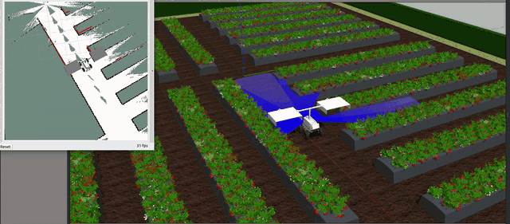
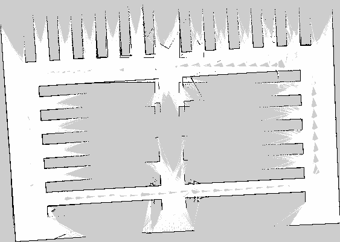
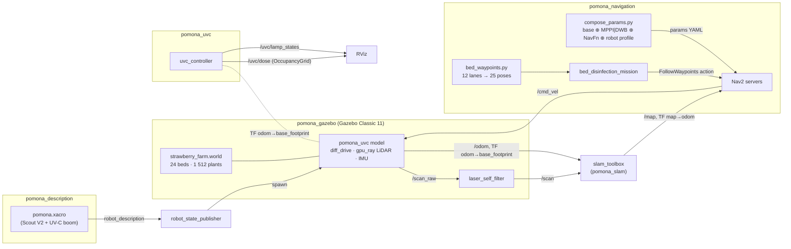
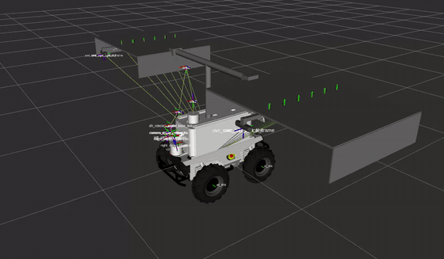
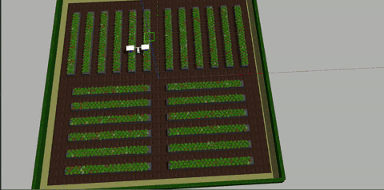

# Pomona Nexus

**A ROS 2 Humble workspace for an AgileX Scout V2 field robot that maps a strawberry farm, navigates its furrows and sweeps every bed with a UV-C disinfection boom, in Gazebo Classic and on hardware.**

[](https://docs.ros.org/en/humble/)
[](LICENSE)



<sub>`pomona_uvc` driving the simulated strawberry farm while SLAM Toolbox builds the occupancy grid.</sub>

---

## Problem

Powdery mildew on strawberries can be treated with UV-C light, but the lamps
have to pass close over every plant, bed after bed. Pomona is a skid-steer
Scout V2 base carrying a cantilever boom with two downward lamp panels spaced
to straddle a pair of raised beds. The workspace provides everything needed to
run that job autonomously in simulation: the robot models, a procedurally
generated farm, 2D SLAM, a Nav2 stack, a waypoint mission over every bed pair
and a node that switches the lamps and accumulates a UV-C dose map.

## Key numbers

All figures below come from the code and data in this repository.

| | Value | Source |
|---|---|---|
| Farm layout | 24 beds (6 per quadrant, 10 m × 1 m), 1 512 plants | `generate_strawberry_farm.py` output |
| Plant mix | 1 130 ripe · 76 half-ripe · 85 unripe · 76 flower · 69 mildew · 76 leaf-scorch | same (seed 42) |
| UV-C boom | 12 lamps, 2 panels at ±1.0 m → one pass covers 2 beds | `uvc_controller.py`, `bed_waypoints.py` |
| Coverage route | 12 lanes (3 per quadrant), 25 Nav2 waypoints incl. return home | `bed_waypoints.py` |
| Saved SLAM map | 563 × 401 cells at 0.05 m/cell (≈ 28.2 m × 20.1 m) | `src/pomona_slam/maps/strawberry_farm.yaml` |
| Dose map | 480 × 480 cells at 0.05 m/cell (24 m square) | `uvc_controller.py` defaults |

TODO: no quantitative evaluation (mission time, coverage fraction, localisation
error) is recorded in the repository yet.

<p align="center">
  <br/>
  <sub>The saved occupancy grid of the farm (<code>maps/strawberry_farm.pgm</code>).</sub>
</p>

---

## Architecture

Simulation path for the autonomous disinfection mission (`pomona_uvc` model):



| Package | Role |
|---|---|
| [`pomona_description`](src/pomona_description/README.md) | URDF/xacro and meshes for two models: `pomona_original` (xArm6 + AG95 gripper) and `pomona_uvc` (UV-C boom) |
| [`pomona_gazebo`](src/pomona_gazebo/README.md) | Gazebo Classic 11 worlds, crop/environment models, spawn launches, LiDAR self-return filter |
| [`pomona_slam`](src/pomona_slam/README.md) | SLAM Toolbox online mapping, localisation and map saving |
| [`pomona_navigation`](src/pomona_navigation/README.md) | Launch-time Nav2 parameter composer, Nav2 bringup, bed-disinfection mission |
| [`pomona_uvc`](src/pomona_uvc/README.md) | UV-C lamp services and dose-map publisher |
| [`pomona_moveit_config`](src/pomona_moveit_config/README.md) | MoveIt 2 configuration for the arm (stub) |
| [`pomona_bringup`](src/pomona_bringup/README.md) | Real-robot drivers and udev/CAN setup (stubs) |
| `pomona_msgs` | Custom interfaces (none defined yet) |

---

## Tested versions

| Component | Version | How it was checked |
|---|---|---|
| Ubuntu | 22.04 | CI (`ros:humble-ros-base` container) |
| ROS 2 | Humble | CI: `colcon build` of all 8 packages, xacro → `check_urdf` for both robot models |
| Python | 3.10 | CI: `pip install`, import and unit tests of `pomona_navigation.launch_utils` |
| Gazebo | Classic 11 | Target simulator; not exercised in CI |
| Nav2 / SLAM Toolbox / MoveIt 2 | Humble binaries | Runtime dependencies; not exercised in CI |

---

## Install

```bash
# ROS 2 Humble on Ubuntu 22.04 must already be installed.
mkdir -p ~/pomona_ws && cd ~/pomona_ws
git clone <this-repo-url> pomona_nexus
cd pomona_nexus

source /opt/ros/humble/setup.bash
rosdep install --from-paths src --ignore-src -y   # Gazebo, Nav2, SLAM Toolbox, MoveIt, ...
colcon build --symlink-install
source install/setup.bash
```

Verified: `colcon build` (without `rosdep install`, `-DBUILD_TESTING=OFF`)
completes for all 8 packages in a clean `ros:humble-ros-base` container; the CI
workflow repeats this on every push.

> **Strawberry plant meshes are not included.** They are derived from a
> third-party model that may not be redistributed; the farm world loads the
> beds, ground and hedge, but the plants need to be rebuilt locally. See
> [`cad_assets_studio/strawberry/README.md`](cad_assets_studio/strawberry/README.md).

## Run

Verified without a simulator:

```bash
# Print the 25-pose coverage route
python3 src/pomona_navigation/pomona_navigation/launch_utils/bed_waypoints.py

# Regenerate the farm world (24 beds, 1 512 plants; output is deterministic)
python3 src/pomona_gazebo/worlds/strawberry/generate_strawberry_farm.py

# Unit tests for the Nav2 parameter composer and the waypoint generator
pip install ./src/pomona_navigation pyyaml pytest
python3 -m pytest -q src/pomona_navigation/test
```

Full simulation (needs Gazebo Classic 11 and a display; these commands are taken
from the package documentation and were not re-run for this release):

```bash
# Terminal 1: farm + robot + teleop
ros2 launch pomona_gazebo strawberry_farm.launch.py

# Terminal 2: SLAM + Nav2 + autonomous bed sweep
ros2 launch pomona_navigation autonomous_waypoint.launch.py controller:=mppi

# Terminal 3: UV-C lamps and dose map
ros2 launch pomona_uvc uvc_control.launch.py rviz:=true
ros2 service call /uvc/all std_srvs/srv/SetBool "{data: true}"

# Optional: save the map the mission built
ros2 launch pomona_slam save_map.launch.py map_name:=strawberry_farm
```

Robot model only (RViz):

```bash
ros2 launch pomona_description display_pomona_uvc.launch.py
ros2 launch pomona_description display_pomona_original.launch.py
```

See [`docs/sim_runbook.md`](docs/sim_runbook.md) for the launch timeline,
per-subsystem checks and known failures.

---

## Results

| | |
|---|---|
|  |  |
| `pomona_uvc`: Scout V2 base, deck box and cantilever UV-C boom | The pinwheel strawberry farm in Gazebo (1.5× speed) |

- SLAM Toolbox produced the saved occupancy grid of the farm shown above
  (0.05 m resolution).
- The coverage route visits all 24 beds in 12 passes because each pass
  straddles a bed pair with the ±1.0 m lamp panels.
- The UV-C node integrates a distance-weighted dose under each lit lamp and
  publishes it as an occupancy grid, so coverage can be inspected in RViz.

TODO: add measured mission duration and dose-coverage statistics.

---

## Repository layout

```
pomona_nexus/
├── src/                        ROS 2 packages (colcon root)
│   ├── pomona_description/     URDF/xacro + meshes (two robot models)
│   ├── pomona_gazebo/          worlds, Gazebo models, sim launches, self-filter node
│   ├── pomona_slam/            SLAM Toolbox configs, launches, saved map
│   ├── pomona_navigation/      Nav2 composer, launches, mission node, tests
│   ├── pomona_uvc/             UV-C lamp/dose node
│   ├── pomona_moveit_config/   MoveIt 2 config (stub)
│   ├── pomona_bringup/         real-robot drivers (stubs)
│   └── pomona_msgs/            custom interfaces (empty)
├── cad_assets_studio/          Blender/FreeCAD scripts that build the Gazebo assets
├── docs/sim_runbook.md         simulation runbook and troubleshooting
├── media/                      demo GIFs and the rendered map
├── .github/workflows/ci.yml    build + test workflow
├── CITATION.cff
└── LICENSE
```

---

## Hardware (real robot)

| Component | Make / model | Interface |
|---|---|---|
| Mobile base | AgileX Scout V2 (4-wheel skid steer) | CAN `can0` @ 500k |
| Manipulator | UFactory xArm6 | Ethernet |
| Gripper | DH Robotics AG95 | USB serial |
| RGB-D camera | Intel RealSense D435 | USB 3 |
| 3D LiDAR | Robosense (rslidar) | Ethernet |
| IMU | Xsens MTi | USB |

The hardware launch files in `pomona_bringup` are stubs; see its README for
which drivers still need porting.

---

## Acknowledgements

- Robot meshes: AgileX Robotics (`scout_ros`), UFactory (`xarm_ros`) and
  DH Robotics (AG95 gripper model); see
  [`src/pomona_description/meshes/ATTRIBUTION`](src/pomona_description/meshes/ATTRIBUTION).
- Built on [Nav2](https://navigation.ros.org/),
  [SLAM Toolbox](https://github.com/SteveMacenski/slam_toolbox),
  [MoveIt 2](https://moveit.ai/) and Gazebo Classic.
- TODO: name the collaborators who contributed to this project.

## Licence

Apache-2.0 — see [LICENSE](LICENSE). Third-party meshes keep their upstream
licences as listed in `src/pomona_description/meshes/ATTRIBUTION`.

## Author

**Pravin Oli** · [GitHub](https://github.com/Rudip1) ·
[LinkedIn](https://www.linkedin.com/in/pravin-oli-2851662ab)
